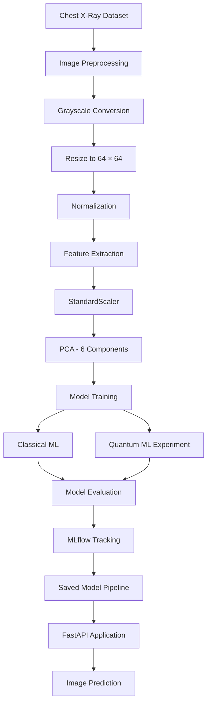
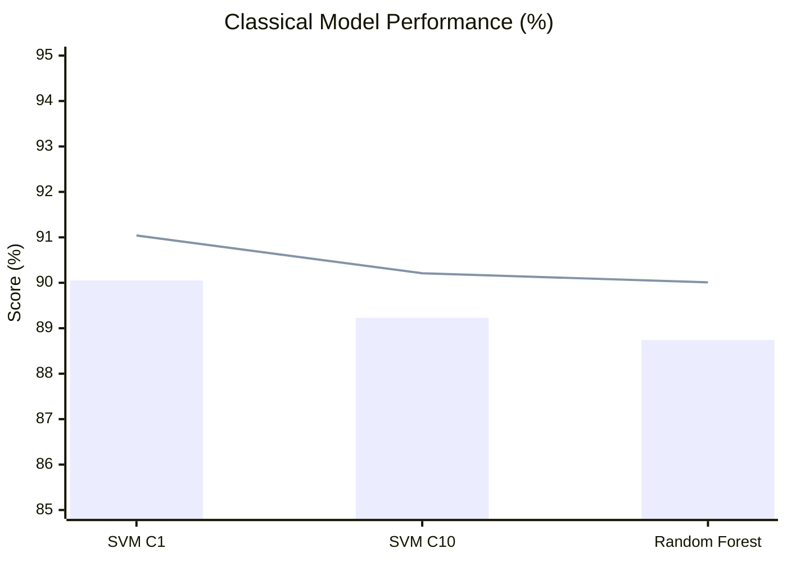

# ⚛️ Quantum ML for Pneumonia Classification

<p align="center">
  
</p>

<h3 align="center">Bridging Quantum Computing, Artificial Intelligence and Medical Imaging</h3>

<p align="center">
  An experimental machine learning project for classifying chest X-ray images into NORMAL and PNEUMONIA categories using classical and quantum machine learning approaches.
</p>

<p align="center">
  
  
  
  
  
  
  
</p>

<p align="center">
  <a href="https://quantum-ml-medical-image-classification.onrender.com/"><strong>🌐 Live Application</strong></a>
  &nbsp; • &nbsp;
  <a href="https://github.com/ParulRana2907/Quantum-ML-Medical-Image-Classification"><strong>💻 GitHub Repository</strong></a>
  &nbsp; • &nbsp;
  <a href="https://quantum-ml-medical-image-classification.onrender.com/docs"><strong>📘 API Documentation</strong></a>
</p>

---

## 🌟 01. Project Overview

Can Quantum Machine Learning contribute to the future of medical image classification?

This project explores this question through an experimental comparison of classical machine learning and quantum machine learning techniques for chest X-ray image classification.

The system analyzes chest X-ray images and predicts one of two categories:

- 🟢 **NORMAL:** Images belonging to the normal category.
- 🔴 **PNEUMONIA:** Images belonging to the pneumonia category.

The project combines image preprocessing, feature extraction, dimensionality reduction, classical classification algorithms, an exploratory quantum classifier, experiment tracking and a deployable prediction API.

### 🎯 Project Objectives

- Develop an image classification pipeline for chest X-ray images.
- Implement and evaluate classical machine learning algorithms.
- Explore a Quantum Support Vector Classifier (QSVC).
- Apply PCA for dimensionality reduction.
- Track experiments and performance metrics using MLflow.
- Develop a FastAPI-based prediction application.
- Automate testing and deployment workflows.

## ✨ 02. Key Features

| Feature | Description |
|---|---|
| 🩻 Medical Image Classification | NORMAL and PNEUMONIA classification |
| 🧠 Classical ML | SVM and Random Forest models |
| ⚛️ Quantum ML | Experimental QSVC implementation |
| 📉 Feature Reduction | StandardScaler and PCA |
| 📊 Experiment Tracking | MLflow metrics and model tracking |
| 🚀 REST API | FastAPI-based image prediction |
| 🧪 Automated Testing | Pytest test suite |
| 🐳 Containerization | Docker deployment |
| 🔄 CI Workflow | GitHub Actions |
| ☁️ Cloud Hosting | Render deployment |

## 🏗️ 03. System Architecture

The project follows a modular machine learning workflow.



### 🔬 Workflow Explanation

1. **Dataset Loading:** Chest X-ray images are loaded from the dataset.
2. **Preprocessing:** Images are converted to grayscale, resized and normalized.
3. **Feature Scaling:** StandardScaler standardizes image features.
4. **Dimensionality Reduction:** PCA reduces the feature dimensions to six components.
5. **Model Training:** Classical models are trained and evaluated; a separate quantum experiment explores QSVC.
6. **Experiment Tracking:** MLflow records model parameters and performance metrics.
7. **Deployment:** The selected classical model pipeline is integrated with FastAPI.

## 🩻 04. Dataset

**Dataset Name:** Chest X-Ray Images (Pneumonia)

**Dataset Source:** [Kaggle – Chest X-Ray Images (Pneumonia)](https://www.kaggle.com/datasets/paultimothymooney/chest-xray-pneumonia)

The dataset contains chest X-ray images organized into NORMAL and PNEUMONIA categories.

### Dataset Directory Structure

```text
data/
└── chest_xray/
    ├── train/
    │   ├── NORMAL/
    │   └── PNEUMONIA/
    ├── test/
    │   ├── NORMAL/
    │   └── PNEUMONIA/
    └── val/
        ├── NORMAL/
        └── PNEUMONIA/
```

### Image Preprocessing

| Step | Technique |
|---|---|
| Image loading | OpenCV / Pillow |
| Color conversion | Grayscale |
| Image resizing | 64 × 64 pixels |
| Normalization | Pixel values divided by 255 |
| Feature scaling | StandardScaler |
| Dimensionality reduction | PCA with 6 components |

The classical training pipeline uses a stratified training-validation split, while the held-out test directory is kept separate from model selection.

## ⚙️ 05. Classical Machine Learning

Three classical machine learning configurations were evaluated.

| Model | Configuration |
|---|---|
| SVM 1 | RBF kernel, C = 1 |
| SVM 2 | RBF kernel, C = 10 |
| Random Forest | 100 estimators, maximum depth = 15 |

### Why These Models?

- **Support Vector Machine:** Evaluates classification using an RBF kernel.
- **Random Forest:** Combines multiple decision trees for classification.
- **PCA:** Reduces feature dimensionality before classification.

## ⚛️ 06. Quantum Machine Learning

An exploratory Quantum Support Vector Classifier (QSVC) experiment was conducted to investigate quantum feature mapping for image classification.

### Quantum Model Configuration

| Component | Configuration |
|---|---|
| Classifier | QSVC |
| Feature Map | ZZFeatureMap |
| Number of Qubits | 6 |
| Repetitions | 2 |
| Training Sample | 80 images |
| Validation Sample | 40 images |

The quantum experiment uses a smaller sample and is presented as an exploratory experiment rather than a directly comparable benchmark against the classical training pipeline.

## 📊 07. Model Performance & Results

The following results represent the validation metrics recorded during the classical MLflow experiments.

### Classical Model Comparison

| Model | Accuracy | Precision | Recall | F1-score |
|---|---:|---:|---:|---:|
| 🥇 SVM (C=1) | **90.05%** | 92.26% | 89.86% | **91.04%** |
| SVM (C=10) | 89.23% | **92.40%** | 88.12% | 90.21% |
| Random Forest | 88.74% | 89.88% | **90.14%** | 90.01% |

### 📈 Performance Visualization

The chart compares validation accuracy and F1-score across the three classical models.



**Chart interpretation:** Bars represent accuracy; the line represents F1-score.

### 🔍 Key Observations

- SVM with C=1 achieved the highest validation accuracy and F1-score.
- SVM with C=10 achieved the highest precision.
- Random Forest achieved the highest recall.
- SVM with C=1 was selected as the best-performing classical configuration based on validation accuracy and F1-score.

### Quantum Experiment Results

The exploratory QSVC experiment produced the following results on its smaller validation sample.

| Metric | QSVC Result |
|---|---:|
| Accuracy | 55.00% |
| Precision | 57.58% |
| Recall | 82.61% |
| F1-score | 67.86% |

**Research note:** The classical and quantum results were obtained using different evaluation sample sizes. Therefore, these results should not be interpreted as a controlled head-to-head comparison.

## 📊 08. Experiment Tracking with MLflow

MLflow is used to record and organize machine learning experiments.

### Information Tracked

- Model parameters
- Accuracy
- Precision
- Recall
- F1-score
- Model artifacts

### Launch MLflow

```bash
python -m mlflow ui --backend-store-uri sqlite:///mlflow.db
```

Open the dashboard:

`http://127.0.0.1:5000`

## 🚀 09. FastAPI Application

The selected classical model pipeline is integrated into a FastAPI application for image prediction.

### 🌐 Live Application

**[Open Quantum ML Pneumonia Classification](https://quantum-ml-medical-image-classification.onrender.com/)**

### API Endpoints

| Endpoint | Method | Description |
|---|---|---|
| `/` | GET | Application homepage |
| `/health` | GET | API health check |
| `/docs` | GET | Interactive API documentation |
| `/predict` | POST | Upload an image and receive a prediction |
| `/predict-page` | GET | Prediction page |

### Prediction Workflow

1. Upload a chest X-ray image.
2. The application validates the uploaded image.
3. The image is converted to grayscale and resized.
4. The saved scaler and PCA transform the image features.
5. The trained model generates a prediction.
6. The API returns the predicted class and confidence.

## 🖥️ 10. Application Screenshots

Screenshots are included to demonstrate the application interface and implementation.

> Save your actual screenshots in the `screenshots/` directory using the filenames below. If your existing screenshot filenames differ, update these image paths accordingly.

### Application Homepage


### Prediction Result


### MLflow Experiment Dashboard


### API Documentation


### Docker / Deployment


## 🧪 11. Testing & Quality Assurance

The application includes automated tests using Pytest.

### Test Coverage

| Test | Purpose |
|---|---|
| Homepage test | Checks application homepage |
| Health test | Checks API health endpoint |
| Prediction test | Tests valid image prediction |
| Missing input test | Checks missing image handling |
| Invalid file test | Checks unsupported file content type |

### Run Automated Tests

```bash
python -m pytest test_app.py -v
```

### CI Training Smoke Test

```bash
python ci_train.py
```

The synthetic training smoke test checks the training components independently of the actual chest X-ray dataset. It does not replace the real dataset training process.

## 🐳 12. Docker Deployment

The application can be packaged and executed using Docker.

### Build Docker Image

```bash
docker build -t quantum-ml-pneumonia .
```

### Run Docker Container

```bash
docker run -d -p 10000:10000 --name quantum-pneumonia quantum-ml-pneumonia
```

Open the application:

`http://localhost:10000`

## 💻 13. Installation & Local Setup

Follow these steps to run the project locally.

### Step 1: Clone Repository

```bash
git clone https://github.com/ParulRana2907/Quantum-ML-Medical-Image-Classification.git

cd Quantum-ML-Medical-Image-Classification
```

### Step 2: Create Virtual Environment

```bash
python -m venv .venv
```

Activate on Windows:

```bash
.venv\Scripts\activate
```

### Step 3: Install Dependencies

```bash
python -m pip install --upgrade pip

pip install -r requirements.txt
```

### Step 4: Download Dataset

Download the dataset from Kaggle and place it inside:

`data/chest_xray/`

Use the directory structure described in the dataset section.

### Step 5: Train the Classical Models

```bash
python train.py
```

The training pipeline records experiments in MLflow and saves the selected model pipeline to:

`model/best_model_pipeline.joblib`

### Step 6: Run the API

```bash
uvicorn app:app --reload
```

Open:

`http://127.0.0.1:8000`

### Step 7: Open API Documentation

`http://127.0.0.1:8000/docs`

**Note:** The quantum experiment is a separate exploratory workflow. Its Qiskit dependencies and notebook environment may need to be installed separately if you want to reproduce that experiment.

## 🛠️ 14. Technology Stack

| Category | Technologies |
|---|---|
| Programming Language | Python |
| Image Processing | OpenCV, Pillow |
| Data Processing | NumPy, Pandas |
| Classical Machine Learning | Scikit-learn |
| Quantum Machine Learning | Qiskit, QSVC |
| Dimensionality Reduction | PCA |
| Experiment Tracking | MLflow |
| Backend Framework | FastAPI |
| Testing | Pytest |
| Containerization | Docker |
| CI/CD | GitHub Actions |
| Cloud Deployment | Render |
| Version Control | Git, GitHub |

## 📁 15. Repository Structure

```text
Quantum-ML-Medical-Image-Classification/
│
├── app.py
├── train.py
├── ci_train.py
├── test_app.py
│
├── requirements.txt
├── requirements-serve.txt
├── Dockerfile
├── README.md
│
├── model/
│   └── best_model_pipeline.joblib
│
├── static/
│   └── index.html
│
├── screenshots/
│   ├── project-banner.png
│   ├── homepage.png
│   ├── prediction-result.png
│   ├── mlflow-dashboard.png
│   ├── api-docs.png
│   └── docker-deployment.png
│
└── .github/
    └── workflows/
        └── tests.yml
```

## 🔮 16. Future Scope

The project can be extended in several directions:

- Evaluate the models on larger and more diverse datasets.
- Explore additional quantum feature maps and quantum classifiers.
- Perform controlled classical-versus-quantum comparisons.
- Investigate deep learning and transfer learning architectures.
- Integrate explainable AI techniques for model interpretability.
- Improve experiment tracking and reproducibility.
- Explore additional medical image classification tasks.

## ⚠️ 17. Limitations & Responsible Use

- This is an academic research and demonstration project.
- The application is not a medical diagnostic tool.
- Predictions must not replace professional medical evaluation.
- Dataset quality and class distribution may influence model performance.
- The quantum experiment uses a smaller sample and requires further evaluation.
- The reported validation metrics do not establish clinical effectiveness.

## 👩‍💻 18. Project Information

| Detail | Information |
|---|---|
| Project Title | Quantum ML for Pneumonia Classification |
| Domain | Artificial Intelligence and Machine Learning |
| Subdomains | Quantum Computing and Medical Imaging |
| Developer | Parul Rana |
| Repository | [GitHub](https://github.com/ParulRana2907/Quantum-ML-Medical-Image-Classification) |
| Live Application | [Render Deployment](https://quantum-ml-medical-image-classification.onrender.com/) |

---

<p align="center">
  <h3>⚛️ Exploring the Future of Intelligent Healthcare</h3>
  <i>Combining Classical and Quantum Machine Learning for an academic exploration of medical image classification.</i>
</p>

<p align="center">
  ⭐ If you find this project interesting, consider starring the repository!
</p>